<div align="center">

# 🏫 AWS School Management System

### Deployed with Terraform · Hosted on EC2 · Served by Nginx

*A cloud-hosted School Management System webpage, provisioned end-to-end using Infrastructure as Code.*

**`🟣 Terraform`** **`☁️ AWS`** **`🖥️ EC2`** **`🪣 S3`** **`🌍 Nginx`** **`🐧 Amazon Linux 2023`**

[Overview](#-overview) •
[Architecture](#-architecture) •
[AWS Services](#-aws-services-used) •
[Getting Started](#-getting-started) •
[Security](#-security-configuration) •
[Author](#-author)

</div>

---

## 📖 Overview

This project shows how to **provision AWS infrastructure and deploy a static website on an EC2 instance using Terraform**.

The website file (`School.html`) is kept in a **private Amazon S3 bucket**. When the EC2 instance starts, it **downloads the file automatically** and serves it through **Nginx**, with no manual setup and no stored access keys.

> 💡 One command (`terraform apply`) builds the network, the server, the permissions and the website.

### ✨ Highlights

- 🧱 **Fully automated** infrastructure with Terraform
- 🔒 **Private S3 bucket** with public access blocked
- 🔑 **IAM role**, not hard-coded credentials
- 🌐 **Custom VPC** with two public subnets
- 🚀 **Auto-deployed website** on first boot
- 🛡️ **Least-privilege** access: EC2 can only read the website object

---

## 🏗️ Architecture

<div align="center">



</div>

<details>
<summary>📟 Plain-text version</summary>

```
              Internet
                  |
           Internet Gateway
                  |
              AWS VPC
             10.0.0.0/16
                  |
          Public Subnets
           /          \
      Subnet 1       Subnet 2
      10.0.1.0/24    10.0.2.0/24
           |
       EC2 Instance
       Amazon Linux 2023
           |
         Nginx
           |
   School Management Website
           |
      Private S3 Bucket
      School.html
```

</details>

---

## ☁️ AWS Services Used

| Service | Purpose |
|:--|:--|
| 🌐 **Amazon VPC** | Isolated cloud network |
| 🧩 **Public Subnets** | Network placement for resources |
| 🚪 **Internet Gateway** | Internet connectivity |
| 🗺️ **Route Table** | Routes internet-bound traffic |
| 🛡️ **Security Group** | Controls inbound and outbound traffic |
| 🖥️ **Amazon EC2** | Hosts the website |
| 🪣 **Amazon S3** | Stores the website HTML file |
| 👤 **AWS IAM Role** | Grants EC2 permission to access S3 |
| 🪪 **IAM Instance Profile** | Attaches the IAM role to EC2 |
| 🟣 **Terraform** | Provisions everything as code |

---

## 📁 Project Structure

```
terraform-school-management-system/
│
├── 📄 main.tf                 # All AWS infrastructure definitions
├── 🌐 School.html             # The School Management website
├── 🔐 .terraform.lock.hcl     # Provider version lock
├── 🙈 .gitignore              # Keeps state files & secrets out of Git
└── 📘 README.md               # You are here
```

---

## 🚀 Getting Started

### ✅ Prerequisites

- [ ] ☁️ An **AWS account**
- [ ] 🔧 **AWS CLI** configured with valid credentials
- [ ] 🟣 **Terraform** installed
- [ ] 🔀 **Git** installed
- [ ] 🐙 **GitHub CLI** installed

### 📦 Deployment

**1️⃣ Clone the repository**

```bash
git clone https://github.com/talha-zahoor-isra/terraform-school-management-system.git
cd terraform-school-management-system
```

**2️⃣ Initialize Terraform**

```bash
terraform init
```

**3️⃣ Validate the configuration**

```bash
terraform validate
```

**4️⃣ Review the planned changes**

```bash
terraform plan
```

**5️⃣ Deploy the infrastructure**

```bash
terraform apply
```

> Review the plan, then type `yes` when prompted.

### 🌍 Accessing the Website

After deployment finishes:

1. Open the **AWS Console** and find your EC2 instance's **public IPv4 address**.
2. Visit it in your browser:

```
http://YOUR-EC2-PUBLIC-IP
```

### 🧹 Cleaning Up

To avoid AWS charges when you're done:

```bash
terraform destroy
```

---

## 🔐 Security Configuration

| | Measure |
|:-:|:--|
| 🌐 | **HTTP** is allowed on **port 80** |
| 🔑 | **SSH** on **port 22** is restricted to a specified public IP address |
| 🪣 | The **S3 bucket blocks all public access** |
| 👤 | EC2 uses an **IAM role** instead of stored AWS access keys |
| 🎯 | IAM permissions are limited to **reading the website object from S3** |
| 🙈 | Terraform state files and private credentials are **excluded from Git** |

> ⚠️ **Note:** If your public IP address changes, update the SSH security group CIDR in `main.tf`.

---

## 🎓 Learning Outcomes

Through this project I gained hands-on experience with:

- 🌐 AWS networking and VPC configuration
- 🧱 Terraform resource provisioning and dependency management
- 🖥️ EC2 instance deployment and initialization
- 🔐 IAM roles and least-privilege permissions
- 🪣 Private S3 object access
- 🌍 Nginx web server configuration
- 🔀 Git and GitHub version control

---

## 👨‍💻 Author

<div align="center">

**Talha Zahoor**

🐙 [GitHub: talha-zahoor-isra](https://github.com/talha-zahoor-isra)  
📦 [Repository: terraform-school-management-system](https://github.com/talha-zahoor-isra/terraform-school-management-system)

⭐ *If you found this project helpful, consider giving it a star!* ⭐

</div>
